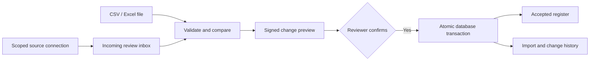

<p align="center">
  
</p>

<h1 align="center">SAMPATI · सम्पाति</h1>

<p align="center"><strong>Bring reports together. Review every change. Keep the source in view.</strong></p>
<p align="center">Air Operations &amp; Resource Decision Support</p>

<p align="center">
  <a href="docs/DEMO.md">Product walkthrough</a> ·
  <a href="docs/SETUP.md">Run locally</a> ·
  <a href="docs/ARCHITECTURE.md">Architecture</a> ·
  <a href="docs/VERIFICATION.md">Verification</a>
</p>

<p align="center">
  <a href="https://github.com/Prathamji1505/sampati/actions/workflows/ci.yml"></a>
  <a href="LICENSE"></a>
  
  
</p>

Sampati turns scattered **CSV and Excel aircraft reports** into a persistent, reviewable register. Inspect what changed, confirm the batch, and trace each accepted record back to its source and import history. Separate organisation workspaces, scoped file connections and role-based access support the full review workflow.

**Current release:** a working local prototype with fictional civilian data. No paid API, model download or external aviation feed is needed. [Start with the three-minute demo](docs/DEMO.md).


*Actual local product screen, captured 7 November 2026. The records are fictional; freshness is evaluated at capture time. [Screenshot provenance](docs/images/README.md).*

## Why Sampati

A new spreadsheet can look current while carrying older information. A repeated file can appear to be a new update. A status without its source timestamp can hide uncertainty.

Sampati makes those distinctions visible. The accepted register changes only after a reviewer sees a preview and explicitly confirms it. Reported availability and report freshness stay separate; history preserves what changed and who confirmed it.

## From a file to a traceable record

| Step | What happens |
| --- | --- |
| **Import** | Upload CSV or `.xlsx`, or start with the downloadable fictional sample. |
| **Inspect** | Read row-specific errors and the proposed new, updated and unchanged records. Preview writes no accepted aircraft data. |
| **Confirm** | A signed, revision-bound preview is checked again. Accepted records, the batch and its audit entries commit together. |
| **Explore** | Search and filter the register, inspect source timestamps, view history, and export the current selection. |

Missing rows never silently delete aircraft. Older reports and conflicting values at the same timestamp are blocked. Replaying equivalent data does not create a duplicate import.

<details>
<summary><strong>See the welcome screen and import workflow</strong></summary>

### The welcome screen


### Review before saving


### Follow the history


### On a phone-sized screen


</details>

## What you can use today

| Capability | Implemented behavior |
| --- | --- |
| **Aircraft register** | Search, status/freshness filters, source details, visible-tab refresh and filtered Excel/CSV/JSON exports. |
| **Reviewed imports** | CSV/Excel templates, whole-batch validation, before/after preview, explicit confirmation and an attributable audit trail. |
| **Organisation workspaces** | Sign-up, sign-in, account-targeted invitations, owner/editor/viewer roles and verified workspace switching. |
| **Data connections** | Scoped, once-shown source keys, key rotation, an incoming review inbox and a changing-file watcher. Connections cannot approve imports. |
| **Overview** | Counts and attention rules computed from accepted records, including stale and future-dated reports. |
| **Report checks** | Explainable source-data findings with suggested next steps; report completeness stays separate from aircraft condition. |
| **Account recovery** | Password changes, session revocation and once-shown, one-time recovery codes. |
| **Local continuity** | PostgreSQL persistence, versioned migrations, backup archives and an isolated restore rehearsal. |

## Run locally

The documented local environment is **Windows with PowerShell**, Python **3.12**, Node.js **22+** compatible with Vite 7, and installed PostgreSQL binaries. PostgreSQL must be on `PATH`, or its `bin` folder set in `POSTGRES_BIN`. [Full setup and troubleshooting](docs/SETUP.md).

```powershell
git clone https://github.com/Prathamji1505/sampati.git
cd sampati

py -3.12 -m venv .venv
.\.venv\Scripts\python.exe -m pip install -r backend\requirements-lock.txt
npm --prefix frontend ci
.\.venv\Scripts\python.exe scripts\dev.py setup
.\.venv\Scripts\python.exe scripts\dev.py start
```

Open **[127.0.0.1:5173](http://127.0.0.1:5173)** and choose **Enter workspace**. The API explorer is at **[127.0.0.1:8000/docs](http://127.0.0.1:8000/docs)**. These are local addresses; a hosted demo is not configured.

The setup command generates local secrets, creates a project-owned database on port **55432**, and applies migrations. Keep `.env` and `.local/` private and together. The existing PostgreSQL service is left alone.

## Built around explicit review



React and TypeScript handle the interface. FastAPI owns validation, authentication and confirmation. PostgreSQL persists organisation-scoped records through SQLAlchemy and Alembic. [Read the architecture and source map](docs/ARCHITECTURE.md).

## Verify the implementation

```powershell
.\.venv\Scripts\python.exe -m pytest backend\tests -q
npm --prefix frontend run build
```

The backend suite covers imports, account isolation, permissions, recovery, source-key scope and the review inbox. Tests require a dedicated database ending in `_test` and use a fresh schema per test. [Verification evidence](docs/VERIFICATION.md) records the actual results and browser checks. [GitHub Actions](.github/workflows/ci.yml) defines the same build, backend tests and migration checks for future pushes.

## For reviewers and event submissions

| Looking for | Start here |
| --- | --- |
| A short product demonstration | [Three-minute walkthrough](docs/DEMO.md) |
| Problem, current scope and next steps | [Submission brief](docs/SUBMISSION.md) |
| Setup and local commands | [Setup](docs/SETUP.md) · [Detailed local workflow](docs/LOCAL_WORKFLOW.md) |
| How the services and data fit together | [Architecture](docs/ARCHITECTURE.md) · [Data dictionary](docs/DATA_DICTIONARY.md) |
| Tested behavior and remaining limits | [Verification](docs/VERIFICATION.md) · [Account model](docs/ACCOUNTS.md) |
| Design and original assets | [Design system](DESIGN.md) · [Asset notices](THIRD_PARTY_NOTICES.md) |

## Scope and next steps

This release demonstrates reliable, human-reviewed fictional report management. It does not provide live tracking, trained predictions, dispatch decisions or airworthiness certification. Reported availability remains source information. The app is configured for loopback HTTP; hosted use needs HTTPS, deployment controls and further review.

Next work includes a reproducible hosted deployment, off-device backup management, email-based account recovery, accessibility review and evaluation with authorised civilian users. These are planned directions, rather than shipped capabilities or validated market outcomes.

## Licence and acknowledgements

Built by **[Pratham Sengar](https://github.com/Prathamji1505)**. The name draws on Sampati's far-reaching sight in the Ramayana.

Source code is available under the [MIT licence](LICENSE). Fonts and third-party packages retain their own terms. The original bird artwork was generated with ImageGen; Codex assisted implementation and repository preparation. [Attribution, provenance and AI-assistance disclosure](THIRD_PARTY_NOTICES.md) · [Contributing](CONTRIBUTING.md) · [Security](SECURITY.md).
