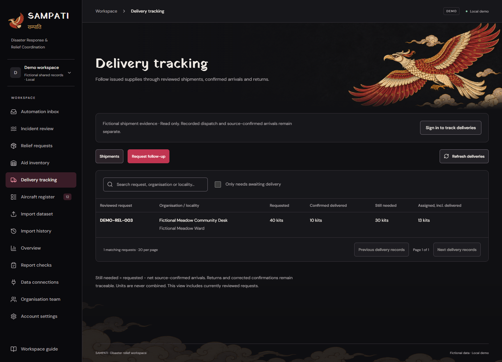
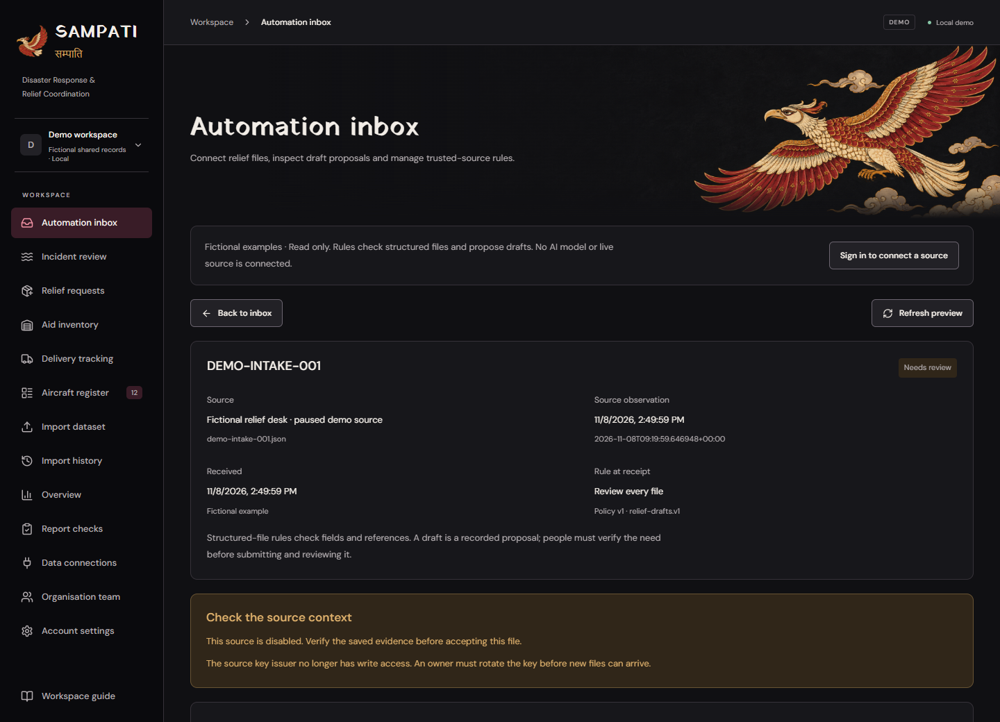
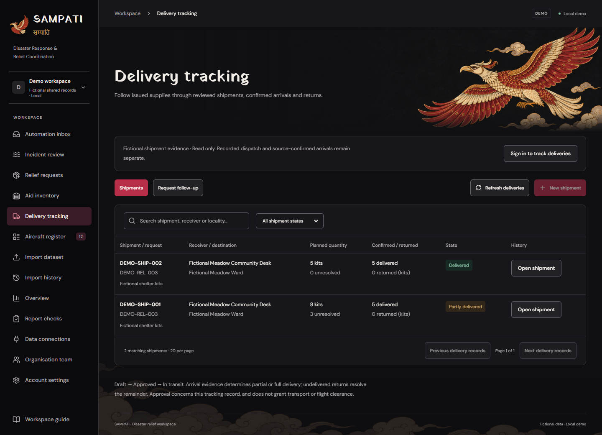
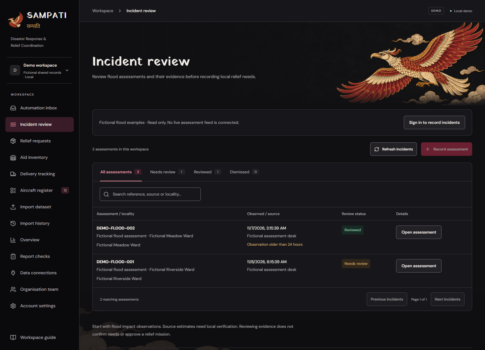
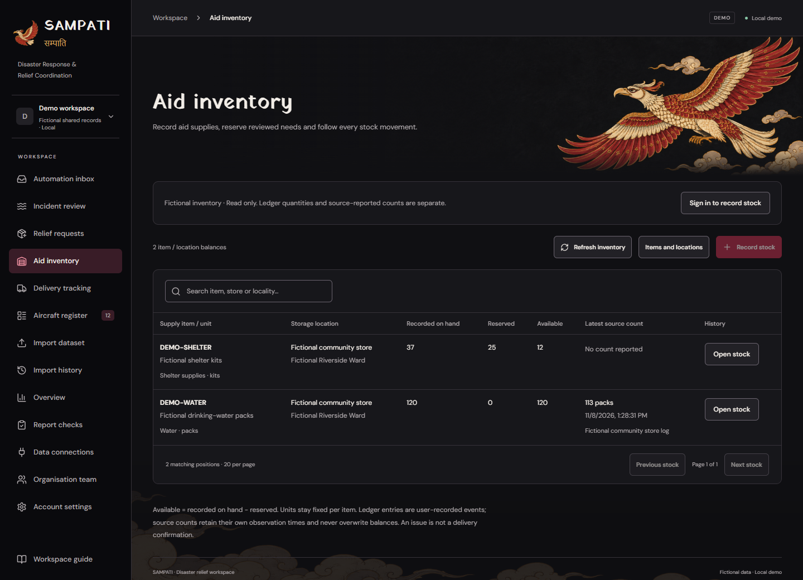
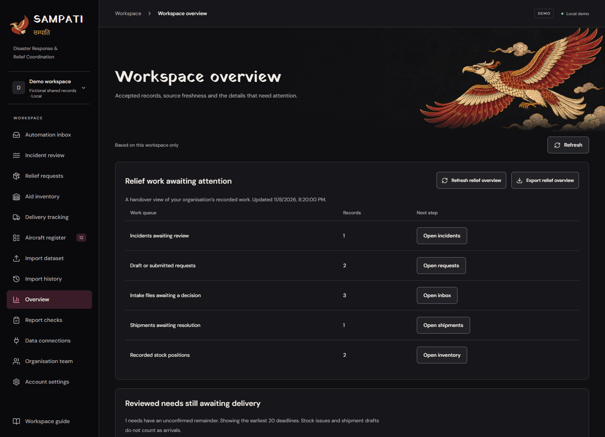
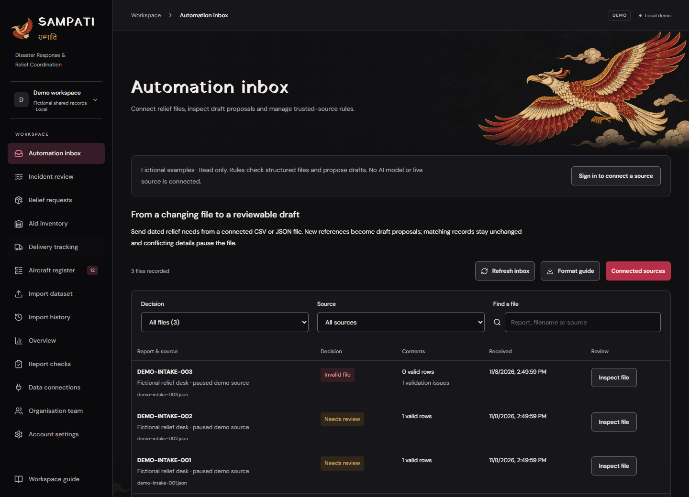
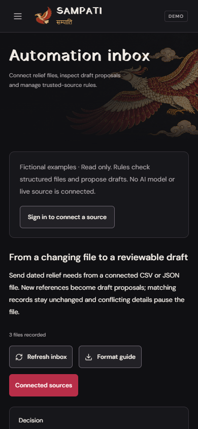

<h1 align="center">SAMPATI · सम्पाति</h1>

<strong>Reviewed needs. Accountable relief.</strong>

  <a href="docs/REVIEWER_GUIDE.md">Product walkthrough</a> ·
  <a href="#see-the-workspace">Screens</a> ·
  <a href="docs/SETUP.md">Run locally</a> ·
  <a href="docs/ARCHITECTURE.md">Architecture</a> ·
  <a href="docs/VERIFICATION.md">Verification</a>

Sampati helps civilian relief teams see **what is needed, what is in stock and what has reached its destination**. It connects flood assessments, reviewed requests, stock movements and delivery records in one organisation workspace, with sources and decisions kept in history.

**Status:** working local release **0.4**, using fictional demonstration records. Incident review, requests, inventory, delivery tracking, structured intake automation and handover are implemented. Public hosting, live feeds, trained AI and field validation remain future work. [Release scope →](docs/RELEASE.md)

*Actual product capture, 8 November 2026. The shared fictional example has 40 kits requested, 10 recorded as arrived and 30 still needed. These are software demonstration records. [Screenshot provenance](docs/images/README.md) · [Follow this example](docs/REVIEWER_GUIDE.md).*

## Why Sampati

A flood assessment, a local request, a store issue and a receiving report describe different facts. When they live in separate files, a team can lose track of what was checked, what was committed and what actually remains unresolved.

The aim is clearer coordination: keep partial deliveries visible, prevent conflicting records from silently replacing accepted information, and give the next shift a traceable picture of outstanding work.

**Who it is for:** relief coordinators review needs; store custodians account for supplies; delivery reviewers record receiving evidence; organisation administrators manage access and source connections.

## How the work flows

1. **Review the evidence.** Inspect dated flood observations, their source and uncertainty.
2. **Confirm the need.** Record the local supply, exact quantity and unit; submit and review the request.
3. **Account for stock.** Receive supplies, reserve reviewed needs and record issues against the reservation.
4. **Follow the shipment.** Review its tracking record, then add source-backed dispatch, partial arrivals or undelivered returns.
5. **Keep the remainder visible.** Follow outstanding needs and review queues from the handover overview.

Transport operators retain authority over actual operations. A stock issue alone never counts as a confirmed arrival.

## See the workspace

### Review evidence and incoming needs

CSV/JSON relief files become **new draft proposals, unchanged duplicates or conflicts**. One invalid row or conflict pauses the whole file. An owner may explicitly trust a source to create new drafts automatically when the file is valid, current and conflict-free; people still submit and review each need. [Automation rules](docs/AUTOMATION.md)

### Keep stock and delivery evidence connected

Exact stock balances, request-linked movements, immutable shipment references and source-backed arrivals make the chain inspectable. Undelivered returns update the original store and shipment together; corrections retain the original evidence. [Inventory](docs/INVENTORY.md) · [Delivery tracking](docs/DELIVERIES.md)

<strong>More actual screens</strong> — incidents, inventory, handover and mobile

#### Flood incident review

#### Aid inventory

#### Relief handover overview

#### Intake register

#### Phone layout

The phone image is browser emulation. Wider tables scroll inside their own region. Captures use the fictional shared demo; dates and freshness reflect capture time. [Open full-size screens and provenance](docs/images/README.md).

## What is implemented

| Area | Working capability | Explore |
| --- | --- | --- |
| **Incident review** | JSON assessment preview, immutable evidence, dates/uncertainty and reasoned review. | [Contract](docs/INCIDENTS.md) |
| **Relief requests** | Exact quantity/unit, locality, deadline, corrections, submission/review/cancellation and history. | [Request rules](docs/RELIEF_REQUESTS.md) |
| **Aid inventory** | Items/stores, protected balances, separate count reports, reservations, issues, releases and returns. | [Stock ledger](docs/INVENTORY.md) |
| **Delivery tracking** | Reviewed tracking, dispatch evidence, partial/full arrivals, returns, corrections and remaining needs. | [Tracking rules](docs/DELIVERIES.md) |
| **Automation Inbox** | Scoped sources, changing-file watcher, raw evidence, conflict previews and optional automatic new drafts. | [Intake rules](docs/AUTOMATION.md) |
| **Handover** | Pending queues, earliest unmet reviewed needs, direct navigation and a dated JSON export. | [Walkthrough](docs/REVIEWER_GUIDE.md) |
| **Supporting reports** | Aircraft CSV/Excel review, source freshness/conflicts, register, history and exports. | [Sources](docs/DATA_SOURCES.md) |
| **Team and continuity** | Roles, sessions, recovery, version guards, migrations, local backup and restore rehearsal. | [Accounts](docs/ACCOUNTS.md) |

Sampati runs with its own contracts and records. Other assessment tools, authorised APIs, forms or database exports can be optional adapters; no particular external product is required.

## Run locally

The documented setup targets **Windows / PowerShell**, Python **3.12**, Node.js compatible with Vite 7, npm and installed PostgreSQL binaries.

~~~powershell
git clone https://github.com/Prathamji1505/sampati.git
cd sampati
py -3.12 -m venv .venv
.\.venv\Scripts\python.exe -m pip install -r backend\requirements-lock.txt
npm --prefix frontend ci
.\.venv\Scripts\python.exe scripts\dev.py setup
.\.venv\Scripts\python.exe scripts\dev.py start
~~~

Open **http://127.0.0.1:5173**. Setup creates private local secrets and a project-owned PostgreSQL cluster on loopback port **55432**. New organisations start empty; the shared demo contains fixed fictional records.

For compiled single-server use, build the interface, stop the development launcher, start the project database and run `scripts/run.py`; the app opens at **http://127.0.0.1:8000**. [Full setup and troubleshooting](docs/SETUP.md) · [Reviewer tour](docs/REVIEWER_GUIDE.md)

## Engineering and verification

**React 19 + TypeScript + Vite** power the interface. **FastAPI + Pydantic** validate contracts and permissions. **SQLAlchemy + Psycopg + PostgreSQL** persist organisation-scoped records; **Alembic** evolves the schema.

Workspace locks, current-version checks and canonical repeat detection protect accepted changes. Exact decimal storage keeps quantities in their declared units. Related stock, shipment and audit records commit atomically.

Recorded local checks on **8 November 2026** include **202 passing backend tests**, the production build, migration consistency, real-browser workflows, actual CSV/JSON watcher submissions, retries/concurrency and a disposable backup restore. These are software checks, not model-accuracy or welfare measurements. [Executed verification and limits](docs/VERIFICATION.md) · [GitHub Actions](https://github.com/Prathamji1505/sampati/actions)

## Explore the project

| Looking for | Start here |
| --- | --- |
| A reproducible product demonstration | [Reviewer guide](docs/REVIEWER_GUIDE.md) |
| What works and what remains unconfigured | [Local release scope](docs/RELEASE.md) |
| Architecture and source files | [Architecture](docs/ARCHITECTURE.md) · [Learning guide](docs/LEARNING_GUIDE.md) |
| Workflow contracts and boundaries | [Requirements](docs/REQUIREMENTS.md) · [Roadmap](docs/ROADMAP.md) |
| Asset origins and screenshot context | [Visual provenance](docs/images/README.md) · [Third-party notices](THIRD_PARTY_NOTICES.md) |

[All documentation, grouped by task →](docs/README.md)

## Next steps

The next milestones are civilian-user evaluation, live source adapters and hosted deployment. Workflow fit, equitable access, savings and humanitarian outcomes still need field evaluation. AI extraction or prediction requires separate implementation and validation; current intake is rule-based. Source reports do not certify aircraft readiness or independently authenticate physical delivery.

Built by **[Pratham Sengar](https://github.com/Prathamji1505)** with assisting partner **GUNNA**. Sampati's bilingual wordmark and approved folk-art bird express the project's own identity. Source code is [MIT licensed](LICENSE); libraries, fonts and artwork retain their documented terms. [Contributing](CONTRIBUTING.md) · [Attribution and AI assistance](THIRD_PARTY_NOTICES.md)
