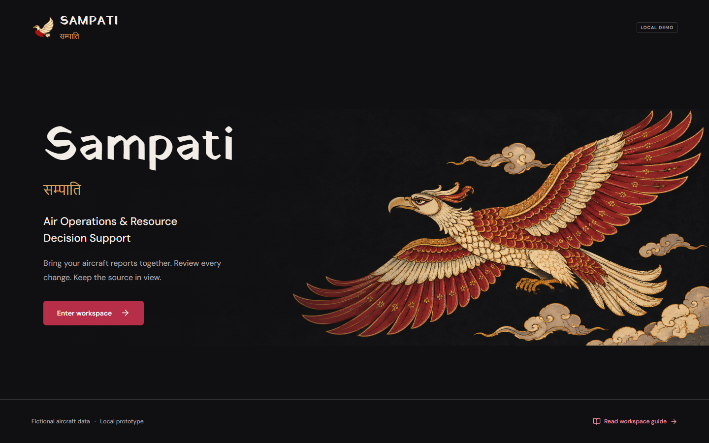
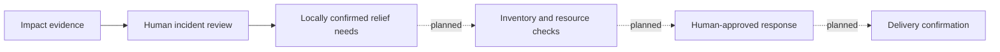
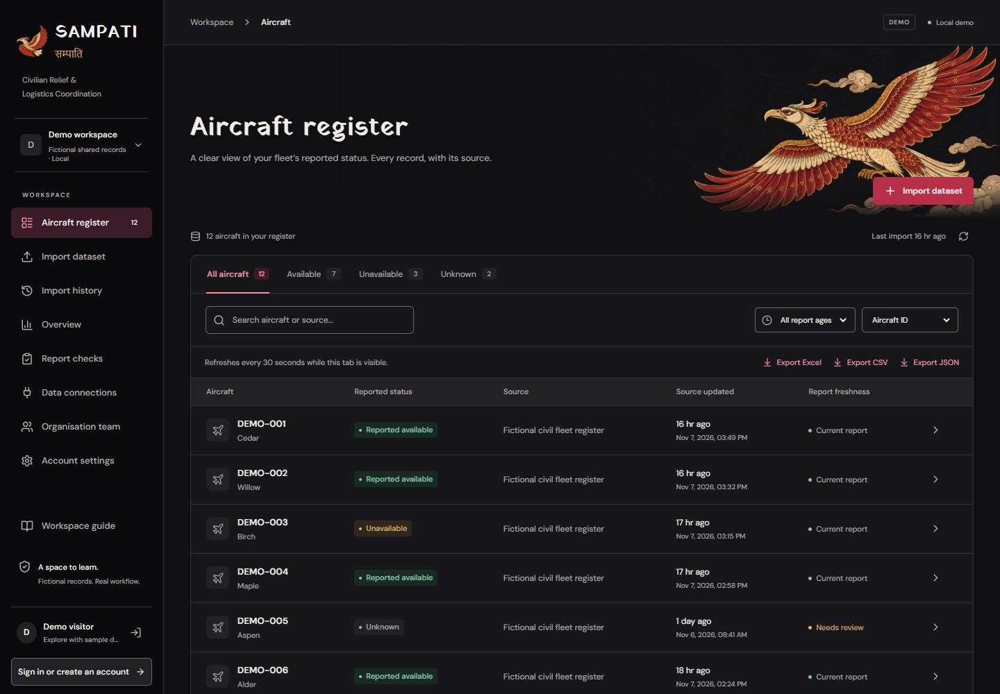
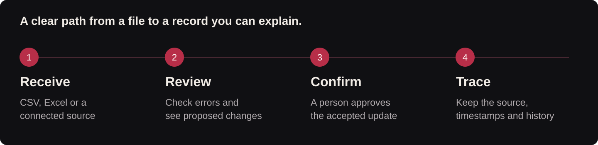
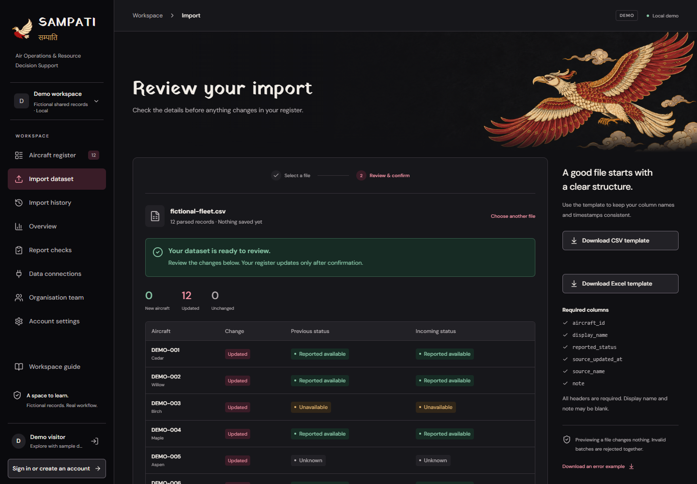
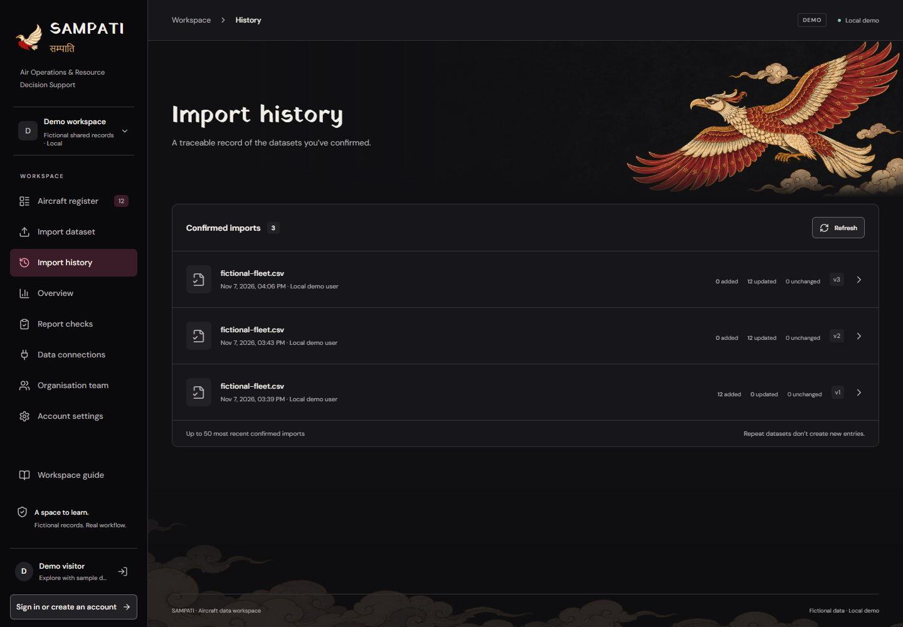
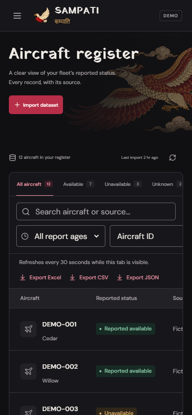

<p align="center"></p>
<h1 align="center">SAMPATI · सम्पाति</h1>
<p align="center"><strong>From flood-impact evidence to reviewed relief needs.</strong></p>
<p align="center">Disaster Response &amp; Relief Coordination</p>

<p align="center">
  <a href="#the-problem">The problem</a> ·
  <a href="#meet-sampati">The product</a> ·
  <a href="docs/DEMO.md">Try the demo</a> ·
  <a href="#where-this-can-grow">Business direction</a> ·
  <a href="docs/SETUP.md">Run locally</a>
</p>

**Sampati is a disaster-response project with a working workspace for reviewed relief requests and aircraft reports.** It brings CSV and Excel files together, explains what has changed, highlights information that needs attention, and keeps a history of accepted updates. A person reviews changes before they enter the shared register.

**Current direction: disaster response.** Sampati is being developed for humanitarian logistics and disaster relief. **Relief requests** now supports drafts, human review, corrections, cancellation and audit history within each organisation. The aircraft-report workspace remains its data-review foundation. Aid inventory and delivery tracking are the next planned modules. [Civilian-welfare charter and build order](docs/CIVILIAN_WELFARE_SCOPE.md).

**Incident review** now accepts a versioned flood-assessment JSON contract, preserves dated evidence and uncertainty, records human review, and opens a linked relief-request draft with human-entered quantities. This is the first local step toward the proposed SATQueryAI connection. A live SATQueryAI connector, aid inventory, mission assignment, delivery tracking and live aircraft positions remain planned. [Incident workflow and shared contract](docs/INCIDENTS.md).

The project builds a practical foundation for disaster-response coordination: **make information understandable, current in context, and traceable before building more advanced decision support.**



<p align="center">
  <a href="https://github.com/Prathamji1505/sampati/actions/workflows/ci.yml"></a>
  <a href="LICENSE"></a>
  
  
</p>

| Project at a glance | |
| --- | --- |
| **Product** | Flood-incident review, relief requests and traceable supporting resource reports |
| **Intended users** | Civilian relief coordinators, aid-inventory custodians and delivery-record reviewers; audiences to validate through pilots |
| **Working today** | Flood-assessment preview/intake and review; linked relief drafts; request lifecycle and audit; supporting aircraft-report tools |
| **Demonstration** | Fictional civilian records; no paid API or model download required |
| **Engineering evidence** | 138 backend tests passed locally on 8 November 2026; production build and recorded browser checks. See docs/VERIFICATION.md for the exact scope; current changes have not been checked by hosted CI. |
| **Stage** | Working prototype with public source; hosted application not yet configured |

## The problem

After a flood, a coordinator needs to connect several different kinds of information: an assessment of the affected area, locally confirmed supply needs, reports about available resources, and evidence that help was delivered. Each can arrive from a different source at a different time.

An impact observation is not yet a confirmed supply request. A recorded request is not yet an approved mission. A planned shipment is not yet a confirmed delivery. Sampati is being built to preserve those distinctions while helping people follow the response from evidence to action.

| Coordination question | Sampati's current response |
| --- | --- |
| Where did the flood assessment come from, and how old is it? | Preserve source evidence, observation/generation/receipt times and uncertainty. |
| Has someone reviewed the assessment? | Record a reasoned human decision with version protection and review history. |
| What supplies are actually requested? | Link a reviewed incident to a draft whose organisation, quantities and units are entered by a person. |
| Who changed the request? | Keep attributed corrections, status changes and before/after history. |
| Can a resource report be trusted as current information? | Keep source timestamps, freshness and conflicts visible in the aircraft-report foundation. |
| What stock is committed, and what reached its destination? | Inventory and delivery tracking are the next development milestones. |

## Meet Sampati

The working prototype now connects three areas:

- **Incident review:** preview a fictional flood assessment, retain its original evidence and uncertainty, and record a review decision.
- **Relief requests:** turn reviewed incident context into a human-entered request, then submit, review, correct or cancel it with an audit trail.
- **Supporting aircraft reports:** inspect source-reported status, freshness, proposed updates and history within a verified organisation workspace.

The intended response chain is shown below. **Inventory, mission coordination and delivery confirmation remain planned.**



The current intake implements the application-owned `sampati.incident.v1` contract. A live SATQueryAI producer must still be connected and verified. [Incident contract](docs/INCIDENTS.md) · [Relief-request workflow](docs/RELIEF_REQUESTS.md).

### Supporting report-review workspace



*Actual product capture with fictional records, 8 November 2026. Freshness reflects capture time. [Screenshot provenance](docs/images/README.md).*

Three questions stay visible throughout the workflow: **What did the source report? When did it report it? Who accepted the change?** Reported availability and data freshness remain separate, so a fresh report with an unknown status is still shown honestly.

## How it works



1. **Bring in a report.** Upload CSV or Excel, use a fictional sample, or receive a file through a scoped source connection.
2. **Understand the update.** Read validation errors and compare new, updated and unchanged records. Previewing a file does not change accepted aircraft data.
3. **Make an explicit decision.** An authorised reviewer confirms an eligible batch. Records and their change history save together.
4. **Work from the accepted picture.** Search, filter, inspect findings, export records and follow the history. Incoming files remain separate until accepted.



### A small example that explains the value

Consider the fictional aircraft **DEMO-001 / Cedar** already in the register:

| What arrives next | What happens |
| --- | --- |
| A file whose source timestamp is earlier than Cedar's accepted report | The older update is blocked from replacing newer information. |
| A corrected file with a later source timestamp | The reviewer sees the proposed changes and can confirm them. |
| The exact accepted file arrives again | Sampati recognises the repeat and avoids a duplicate import. |
| A connected file disagrees at the same source timestamp | It stays pending; report checks explain the conflict for review. |

The core promise is simple: **a file arriving does not automatically make it the accepted truth.** One invalid row rejects the batch, and an aircraft missing from a file is not silently deleted.

**H02 update:** Inventory APIs and migration 006 now implement scoped catalogs, exact stock balances, request-linked reservations and an append-only ledger. The inventory interface and end-to-end browser flow remain work in progress. [Inventory milestone](docs/INVENTORY.md).

## What is already built

| Product area | What a user can do |
| --- | --- |
| **Relief requests** | Record a civilian supply need with exact quantity/unit, locality, deadline and source; submit/review/correct/cancel with a reason and version-protected history. Viewers read; demo examples are read-only. [H01 guide](docs/RELIEF_REQUESTS.md). |
| **Aircraft register** | Search aircraft and sources, filter status/freshness, inspect source details and export the current selection as Excel, CSV or JSON. |
| **Import review** | Use CSV/Excel templates, inspect actionable errors, preview changes and explicitly confirm a batch. |
| **Report checks** | Examine old/future timestamps, unknown status, missing names and pending-file disagreements. Expand evidence, inspect the source record, paginate results and export filtered findings with check time, rule version and register revision. |
| **Overview** | See counts, source coverage and attention rules computed from accepted records. |
| **Data connections** | Create limited ingestion keys, rotate or disable them, receive files into an inbox and review or reject datasets. A local watcher can submit changed files. |
| **Organisation teams** | Invite a specific account, assign owner/editor/viewer roles and switch between verified memberships. |
| **Accounts** | Sign in, change a password, revoke other sessions and recover access with saved one-time codes. |
| **History and continuity** | Inspect confirmed batches and before/after values, retain records across restarts, create backups and rehearse a restore in a disposable database. |

<details>
<summary><strong>Explore the history and mobile interface</strong></summary>





The mobile image is browser emulation. Tables scroll within their own region to preserve readable fields.

</details>

## Who this is designed to help

The initial product hypothesis centres on teams that receive structured civilian fleet reports and need a review process around them.

| Potential user | Task Sampati is designed to support |
| --- | --- |
| **Fleet-data coordinator** | Bring recurring reports into a coherent register and identify records needing follow-up. |
| **Reporting or review team** | Check proposed updates, resolve source disagreements and explain accepted changes. |
| **Relief-logistics coordinator** | Review flood evidence, record locally confirmed needs and follow request decisions. |
| **Organisation administrator** | Give teammates appropriate access and limit what an external source can submit. |

These are intended audiences. Pilot interviews and observed workflow trials are the next step in validating the fit.

## Where this can grow

The governing goal is **civilian disaster response, beginning with flood relief**. The next work follows dependencies, so a recorded delivery can eventually be traced back to a reviewed request and source evidence.

| Stage | Position | Completion gate |
| --- | --- | --- |
| **Relief requests · H01** | Implemented locally | Scoped drafts, exact units/quantities, review, corrections, cancellation and audit history. |
| **Flood-assessment review** | Implemented locally | Versioned JSON intake, immutable evidence, dated uncertainty, reasoned review and linked relief drafts. |
| **Aid inventory · H02** | Backend milestone; interface pending | Attributable receipts/reservations/issues/returns, explicit units and protection against negative or double-issued stock. |
| **Delivery tracking · H03** | Follows inventory | Approved records, partial fulfilment, explicit returns/cancellations and source-backed delivery confirmation. |
| **SATQueryAI adapter** | Integration work | Verify a real producer against the contract, including access, provenance, uncertainty, replays and failure behavior. |
| **Context, evaluation, deployment · H04–H06** | Planned | Useful dated civilian context, measured user trials and a verified hosting/recovery environment. |

Aircraft operators retain dispatch authority. Live positions require an authorised source; reported availability alone does not establish mission readiness.

**Commercial hypothesis:** organisation workspaces with onboarding and connector support. Validate workflow fit, willingness to pay and repeat use with civilian organisations before setting pricing or claiming adoption. Success measures should include review accuracy, time to an approved response plan, confirmed deliveries and unmet-needs follow-up.

[Full roadmap and acceptance gates](docs/ROADMAP.md) · [Civilian-welfare charter](docs/CIVILIAN_WELFARE_SCOPE.md).

## The engineering behind the workflow

| Layer | Technology | Responsibility |
| --- | --- | --- |
| **Interface** | React 19 · TypeScript · Vite | Register, review, checks, team tools and responsive navigation. |
| **Application service** | Python · FastAPI · Pydantic | Validate inputs, check access and handle review/confirmation. |
| **Persistence** | PostgreSQL · SQLAlchemy · Psycopg | Organisation-scoped records, sessions, imports and audit history. |
| **Schema evolution** | Alembic | Versioned database changes that retain existing data. |
| **Verification** | pytest · browser checks · GitHub Actions | Import rules, permissions, source scope, migrations and build integrity. |

The review uses a **signed preview bound to its content, importing account and workspace revision**. Confirmation checks it again and commits related changes atomically. This connects what a reviewer saw with what the database accepts.

Source keys can submit to their own connection; approval stays with a reviewer. Organisation endpoints check current membership and roles. The service enforces these boundaries alongside the interface controls.

[Architecture and source map](docs/ARCHITECTURE.md) · [Account model](docs/ACCOUNTS.md) · [Data dictionary](docs/DATA_DICTIONARY.md)

## Try it in three minutes

After starting the app:

1. Choose **Enter workspace** to open the fictional demo.
2. Open **Import dataset → Use sample**, review the preview, then choose **Confirm import**.
3. Search for `DEMO-001`, inspect its source and try the status/freshness filters.
4. Open **Report checks** to understand findings, then **Import history** to inspect the accepted update.
5. Reload to see the persisted register. Re-upload the same saved file to demonstrate repeat protection.

[Full demo script](docs/DEMO.md) · [Submission brief](docs/SUBMISSION.md)

### Run locally

The documented launcher targets Windows/PowerShell with Python 3.12, Node.js compatible with Vite 7, npm and installed PostgreSQL binaries.

```powershell
git clone https://github.com/Prathamji1505/sampati.git
cd sampati
py -3.12 -m venv .venv
.\.venv\Scripts\python.exe -m pip install -r backend\requirements-lock.txt
npm --prefix frontend ci
.\.venv\Scripts\python.exe scripts\dev.py setup
.\.venv\Scripts\python.exe scripts\dev.py start
```

Open **[127.0.0.1:5173](http://127.0.0.1:5173)**. Setup generates local secrets and a project-owned PostgreSQL cluster on loopback port 55432. [Prerequisites and troubleshooting](docs/SETUP.md).

## Evidence and current scope

Recorded verification includes **138 passing backend tests in the latest recorded local verification**, frontend builds, migration checks, organisation-isolation tests, source-key/inbox checks, browser journeys and a backup/restore rehearsal. [Hosted CI](https://github.com/Prathamji1505/sampati/actions) and [verification notes](docs/VERIFICATION.md) identify the tested builds and limits.

This release uses fictional civilian data in a local application. Its checks describe **source-record quality**; reported status remains source information. Live tracking, trained predictions, operational dispatch, airworthiness certification and production hosting are outside the implemented release. Planned capabilities above remain separate from the working prototype.

[Requirements and acceptance map](docs/REQUIREMENTS.md) · [Security](SECURITY.md) · [Detailed local workflow](docs/LOCAL_WORKFLOW.md)

## The identity behind the product

**Sampati** draws on the far-reaching sight of Sampati in the Ramayana: a fitting idea for a product concerned with seeing information in context. The bilingual wordmark, soaring bird, crimson, charcoal, ivory and restrained saffron give that idea a distinct visual identity.

Built by **[Pratham Sengar](https://github.com/Prathamji1505)**. Source code is available under the [MIT licence](LICENSE). Third-party packages and fonts retain their own terms. Codex assisted implementation and documentation; ImageGen assisted the original artwork. [Attribution and asset provenance](THIRD_PARTY_NOTICES.md) · [Contributing](CONTRIBUTING.md).
