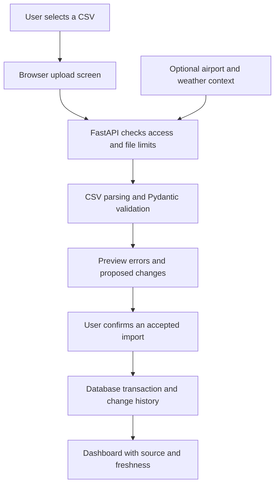

**GUNNU project resource guide — civilian aviation data workspace**

Research checked: 7 November 2026. This is a researched build recommendation, not a working application or a certification of aircraft availability. The scope is a simulated civilian transport/disaster-relief data workspace: upload reported aircraft status, validate information, display changes, and preserve review history. Combat allocation, weapon employment, and threat-driven military retasking are outside this guide.

**The starting decision**

Build the data product first: CSV upload → validation → change preview → confirmed import → status dashboard → history. Use fictional records until an authorised civilian organisation provides suitable data. Add external airport/weather context and AI features only after that path works.

The core demonstration does not require a paid dataset, a trained model, a GPU, or an AI subscription. Hosting and managed services become separate choices when we want to share the application.

Supporting research: [dataset evidence](docs/research/datasets.md) and [stack evidence](docs/research/stack.md). Those notes contain source checks and limitations; recommendations below are our engineering judgement unless described as documented provider behaviour.

**1. Understand the pieces**

| Term | Plain meaning | Example in our project |
| --- | --- | --- |
| Dataset | Structured records | Rows of fictional aircraft status updates |
| CSV | A plain-text table format | A file exported from a spreadsheet |
| Frontend | The interface in the browser | Upload button, table, import preview |
| Backend | The application that checks and processes requests | Verify an upload and save accepted records |
| API | A defined interface for software to exchange requests | The browser asks the backend for the latest records |
| Database | Persistent structured storage | Aircraft records, import history, organisation membership |
| Library | Reusable code we include | A file-upload parser or database connector |
| Framework | A larger structure for building software | React for the interface; FastAPI for the backend |
| Rule | An explicit, testable decision | Reject an update without an aircraft ID |
| Model | A learned statistical pattern | A future, separately evaluated delay estimate |

**2. Which data we actually need**

| Data | Source | Phase | Use and limits |
| --- | --- | --- | --- |
| Aircraft register | Fictional examples, later authorised user uploads | First build | Stable IDs and descriptive fields; a register alone does not establish current availability |
| Reported status updates | Fictional event files, later the organisation's approved source | First build | Reported status with source and observation time; the app displays records rather than certifying airworthiness |
| Import/change history | Generated by our application | First build | Show who imported information, when, what changed, and validation outcomes |
| Organisation membership | Created by the application/account administrator | Before shared use | Control which workspace each user can access; do not trust an uploaded organisation ID as permission |
| Airport reference information | OurAirports | Optional context | Civil airport names, identifiers and coordinates; not current airport conditions |
| Weather observations/forecasts | NOAA Aviation Weather Center | Later integration | Context with observation/forecast timestamps; not evidence of aircraft maintenance or booking status |

No single open dataset was identified in this research that establishes an organisation's current fleet availability. External context cannot replace the user's own current, authorised records. Historical flight delays, engine-simulation data, and position reports answer different questions.

OurAirports publishes downloadable airport data and describes its data as public domain, without an accuracy warranty. Use a small relevant civil-airport subset and record the download date. Direct website retrieval failed during research; its first-party repository and licence were accessible. [OurAirports downloads](https://ourairports.com/data/), [publisher's repository](https://github.com/davidmegginson/ourairports-data)

The Aviation Weather Center provides worldwide METAR observations and TAF forecasts. Documented limits include 100 requests/minute, usually 400 results/query, and no browser cross-origin access. Our optional integration would fetch through the backend, cache responses, and preserve source timestamps. [Official AWC API documentation](https://aviationweather.gov/data/api/)

**3. A small initial dataset specification**

These are proposed application fields, not an aviation standard or an operational readiness model.

| Field | Meaning | Import behaviour |
| --- | --- | --- |
| `aircraft_id` | Stable identifier within a workspace | Required; uniqueness is scoped to the organisation |
| `display_name` | Human-readable label | Optional descriptive field |
| `reported_status` | Source-reported available, unavailable, or unknown | Validate against an agreed vocabulary; retain the original value if mapping is needed |
| `source_updated_at` | When the source says the status was observed/updated | Require an explicit timezone or an agreed, visible conversion rule |
| `source_name` | Where the information came from | Required for traceability |
| `note` | Short source explanation | Optional text; never executed as a command or formula |

The server adds the verified workspace, import ID, receipt time, importing user and change history. Keep raw source values distinct from normalized values. Track data freshness separately from reported status: an old report of availability should visibly become stale rather than continue to look current.

The first sample pack should be small and understandable, for example 10–20 fictional aircraft with a few update files. Include normal updates, a malformed timestamp, duplicate IDs, a missing status, an older report arriving late, an identical re-upload, and an update for an unknown aircraft. Sample counts are our learning choice, not a system-capacity claim. Synthetic scenarios demonstrate application behaviour; they do not prove predictive accuracy.

**4. Recommended tools and libraries**

The proposed stack keeps the interface and data processing separate while letting us learn both. Use one backend application and one database. Install dependencies only when their phase starts.

| Resource | Type | Use | When |
| --- | --- | --- | --- |
| [Python](https://www.python.org/downloads/) | Language/runtime | Backend logic and data processing | Setup |
| [Node.js with npm](https://nodejs.org/en/download) | Runtime and package tooling | Install frontend dependencies and run its development tools | Setup |
| [Git](https://git-scm.com/book/en/v2/Getting-Started-About-Version-Control) | Version-control tool | Save and compare project changes | Setup |
| [React](https://react.dev/learn) | Frontend library | Build upload, preview, dashboard and history screens | First interface |
| [TypeScript](https://www.typescriptlang.org/docs/handbook/intro.html) | Language/tooling | Catch incompatible frontend data shapes while developing | First interface |
| [Vite](https://vite.dev/guide/) | Frontend development/build tool | Run the interface locally and build browser assets | First interface |
| [Browser Fetch API](https://developer.mozilla.org/en-US/docs/Web/API/Fetch_API/Using_Fetch) | Built-in browser API | Send uploads and retrieve backend results | Connect interface to backend |
| [FastAPI](https://fastapi.tiangolo.com/tutorial/) | Backend framework | Define API endpoints and interactive API documentation | First backend |
| [Uvicorn](https://www.uvicorn.org/) | Application server | Run the FastAPI application | First backend |
| [Pydantic](https://docs.pydantic.dev/latest/) | Validation library | Check required fields, dates and allowed status values | First backend; already a FastAPI dependency |
| [python-multipart](https://fastapi.tiangolo.com/tutorial/request-files/) | Upload dependency | Parse multipart form uploads received by FastAPI | Upload feature |
| [Python `csv`](https://docs.python.org/3/library/csv.html) | Standard-library module | Read a small agreed CSV format | Upload feature; no extra package |
| [PostgreSQL](https://www.postgresql.org/docs/current/tutorial.html) | Database server | Store related records and change history | Persistence |
| [SQLAlchemy](https://docs.sqlalchemy.org/en/21/tutorial/) | Database toolkit | Express database operations from Python | Persistence |
| [Psycopg](https://www.psycopg.org/psycopg3/docs/basic/install.html) | PostgreSQL driver | Carry SQLAlchemy/Python requests to PostgreSQL | Persistence |
| [Alembic](https://alembic.sqlalchemy.org/en/latest/tutorial.html) | Database migration tool | Version database structure changes without recreating existing data | Initial schema and subsequent revisions |
| [pytest](https://docs.pytest.org/en/stable/getting-started.html) | Test framework | Check import behaviour and regression cases | Validation feature |
| [HTTPX](https://www.python-httpx.org/) | HTTP client/test dependency | Support FastAPI request tests and, later, backend API calls | API tests |

`fetch` is built into the browser, `csv` is built into Python, PostgreSQL is a separate server, and Pydantic comes through FastAPI. These are different kinds of dependency; we will not blindly install every table entry as a Python package. Work in an isolated Python environment. [Python virtual-environment documentation](https://docs.python.org/3/library/venv.html)

Choose a currently supported Node LTS release satisfying Vite's engine requirements. A framework accepting an old runtime does not make that runtime supported. Verify Python/package compatibility together during setup, then record exact working versions and lock frontend dependencies. The supporting stack note documents the researched version choices; no compatibility installation was performed for this report.

**5. Optional libraries, triggered by a real feature**

| Resource | Add it when | What it contributes |
| --- | --- | --- |
| [openpyxl](https://openpyxl.readthedocs.io/en/stable/) | We accept `.xlsx` uploads | Read workbook cells; agree how formulas, sheets and empty cells are handled; include the parser protections described in its security documentation |
| [pandas](https://pandas.pydata.org/docs/getting_started/index.html) | File transformations become complex | Table cleaning, grouping and analysis; unnecessary for a small fixed CSV reader |
| [Playwright](https://playwright.dev/docs/intro) | The end-to-end browser flow exists | Verify upload → preview → confirm → visible update through the real interface |
| [scikit-learn](https://scikit-learn.org/stable/getting_started.html) | We have an approved prediction task and suitable labelled civil data | Establish and evaluate a simple statistical baseline |

Charts, advanced table libraries, maps, live push updates and background-job infrastructure should each follow a specific need. The initial table can use standard accessible HTML; basic styling can use CSS. Authentication must be implemented and tested before organisations share the application, but a token library alone is not an account-management or workspace-isolation solution.

**6. How the parts connect**

The interface does not connect directly to the database. The backend enforces access, validates inputs and applies imports. PostgreSQL transactions allow related accepted changes to be committed together or rolled back. [PostgreSQL transactions](https://www.postgresql.org/docs/current/tutorial-transactions.html)

**7. Decisions that make changing datasets reliable**

These are proposed engineering requirements for our import workflow:

- Match records using the verified workspace plus stable aircraft ID.
- Distinguish a full snapshot from a partial update; an absent row is not an automatic deletion.
- Preserve observation time and receipt time separately. Flag late or conflicting reports for review instead of silently overwriting newer information.
- Make re-uploading an identical accepted file harmless, without duplicating change events.
- Preview inserted, changed, unchanged and rejected records before confirmation. State whether confirmation applies all valid rows or rejects the batch; keep that policy consistent.
- Recheck relevant records when confirming a preview so another user's newer import is not silently lost.
- Keep original import metadata and an attributable history, with a documented retention policy before real use.
- Preserve the last known report if an external source fails, clearly showing its age and the failed refresh.
- Define freshness thresholds as an explicit demo/product policy, not as an assumed aviation standard.

Because uploading files and separating organisations are central features, include file-size/row-count limits, supported-format checks and server-enforced workspace access from the relevant build stage. Test that a user in one organisation cannot read, change or download another's records, including by changing a request ID. [OWASP file-upload guidance](https://cheatsheetseries.owasp.org/cheatsheets/File_Upload_Cheat_Sheet.html), [OWASP multi-tenant guidance](https://cheatsheetseries.owasp.org/cheatsheets/Multi_Tenant_Security_Cheat_Sheet.html)

PostgreSQL row-level security is one possible additional database boundary. It requires properly configured application roles: table owners and privileged roles can bypass ordinary policies. Merely adding an `organisation_id` column does not establish isolation. [PostgreSQL row-security documentation](https://www.postgresql.org/docs/current/ddl-rowsecurity.html)

**8. Where AI belongs**

| Question | Appropriate first approach | AI/data requirement |
| --- | --- | --- |
| Does this row have an ID and valid timestamp? | Validation rules | No trained model |
| What status did the source report? | Read and normalize the record | No prediction |
| Is this report older than our freshness policy? | Timestamp comparison | No trained model |
| What changed in this import? | Compare accepted records and produce a factual template | A language model is optional later |
| Can we estimate a future civilian service delay? | Define the outcome, collect labelled history, build a baseline | Separate research/evaluation phase |

For any future prediction, define what the model is predicting, at what time, and what information is genuinely available then. Keep chronological holdouts and avoid fitting preprocessing on held-out examples. Aircraft/event grouping may also be needed depending on the intended generalisation; no single split is automatically right. Synthetic labels cannot validate performance on a real organisation's records. [scikit-learn data-leakage guidance](https://scikit-learn.org/stable/common_pitfalls.html)

`TimeSeriesSplit` is a useful learning reference, not an automatic solution for irregular event logs: its documentation notes equally spaced samples for comparable fold metrics. [TimeSeriesSplit documentation](https://scikit-learn.org/stable/modules/generated/sklearn.model_selection.TimeSeriesSplit.html)

Any future language-model summary should be traceable to the accepted records, clearly separated from confirmed source data and reviewed before being relied on. A failed summary must not alter the underlying status. We have not selected a model or external AI provider for this prototype.

**9. Learn by building these milestones**

| Milestone | What we make | What you learn | Main learning resource |
| --- | --- | --- | --- |
| A | A page showing a small fictional table | HTML, CSS, JavaScript and browser behaviour | [MDN web-development course](https://developer.mozilla.org/en-US/docs/Learn_web_development) |
| B | A React version with a file-selection screen | Components, state and TypeScript data shapes | [React Learn](https://react.dev/learn), [TypeScript handbook](https://www.typescriptlang.org/docs/handbook/intro.html) |
| C | A local CSV validation response | Python functions, dictionaries, exceptions and HTTP requests | [Python tutorial](https://docs.python.org/3/tutorial/), [FastAPI tutorial](https://fastapi.tiangolo.com/tutorial/) |
| D | Preview and confirm an import | Validation, error messages and safe state changes | [FastAPI file uploads](https://fastapi.tiangolo.com/tutorial/request-files/), [Pydantic documentation](https://docs.pydantic.dev/latest/) |
| E | Persist data and retain history | SQL tables, keys, queries and transactions | [PostgreSQL tutorial](https://www.postgresql.org/docs/current/tutorial.html), [SQLAlchemy tutorial](https://docs.sqlalchemy.org/en/21/tutorial/) |
| F | Demonstrate late, stale and duplicate updates | Data provenance, ordering and repeatable testing | This guide's import cases; [pytest](https://docs.pytest.org/en/stable/getting-started.html) |
| G | Separate two organisations | Sign-in, permissions and workspace boundaries | [OWASP multi-tenant guidance](https://cheatsheetseries.owasp.org/cheatsheets/Multi_Tenant_Security_Cheat_Sheet.html) |
| H | Add one optional context source | API integration, caching and error handling | [AWC API documentation](https://aviationweather.gov/data/api/) |

Read just enough of each resource to complete its milestone, then explain the behaviour in your own words and make a small change yourself. We can learn the rest as the application grows. The official Python tutorial assumes some programming familiarity; a complete beginner should begin with small variables/functions/files exercises alongside it.

**10. Cost, setup and remaining decisions**

The proposed local demonstration uses public documentation, fictional records and open-source tools. No external API, paid hosting, proprietary dataset or AI subscription is required for its core path. For a shared hosted application we must separately choose authentication, an application host, a persistent database, upload storage, backups and access controls. Provider pricing, quotas, data handling and dataset permissions must be checked for that actual deployment; no hosting provider or budget is fixed here.

A limited shell check found Node.js and Git runnable. The `python` command resolved to a Windows installation alias rather than a working interpreter; `npm` and the PostgreSQL client were not found on the current PATH. This does not prove those tools are absent elsewhere on the computer. Setup should verify existing installations before installing anything. No packages or runtimes were installed during this research.

Before real data is used, we still need the user's actual field definitions, update format, source authority, expected update frequency, data-sharing permission and intended users. The prototype can proceed with an explicit fictional format while these remain open. A civil-airport reference table and weather observations are optional additions, not substitutes for these answers.

**First deliverable:** a fictional CSV template, one upload-and-preview screen, a tested validator, and a dashboard that shows the accepted reported status with its source time. That is the smallest useful foundation for the rest of the project.
