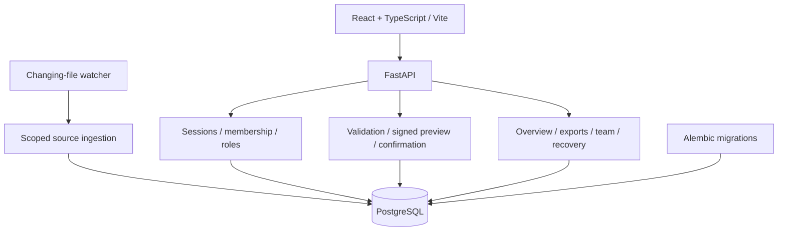

# Architecture and source map

Sampati has a React/TypeScript browser client, a FastAPI service and PostgreSQL persistence. The browser never receives database credentials. Development uses Vite's `/api` proxy; both application services bind to loopback.

## Data lifecycle

## Relief coordination and automation

`incidents.py`, `relief.py`, `inventory.py` and `deliveries.py` own distinct domain transactions: assessment review, needs, stock ledger and shipment evidence. Composite foreign keys keep linked records within an organisation. Workspace/position/shipment locks and version guards protect concurrent changes; exact decimal quantities retain fixed units. A source count, issued quantity and confirmed arrival are separate facts.

`automation_files.py` validates the relief CSV/JSON contract. `automation.py` owns source policies, raw intake evidence, current-request previews, decisions and optional automatic creation of new drafts. Source purposes separate aircraft credentials from relief credentials. A source can never use its key to approve requests or record inventory/delivery actions. New drafts call the existing request creation helper inside the same transaction as intake audit history.

`reports.py` computes the scoped relief overview from current queues and net arrival quantities. No model inference or cross-unit aggregate is used. In packaged local mode, `scripts/run.py` applies migrations and enables static serving of the compiled frontend after API routes.

1. CSV and Excel uploads use the shared schema and batch rules. One invalid row rejects the batch.
2. Preview normalises values, fingerprints the dataset, compares it with accepted records and signs a token bound to content, workspace revision and importing account. It writes no accepted aircraft or import records.
3. Confirmation verifies the token, locks the workspace revision and rechecks the records. Aircraft changes, the import batch and audit entries save in one database transaction.
4. Older reports and same-time contradictory reports are blocked. Equivalent replays return the original import. Missing rows do not delete records.
5. Scoped connections accept files into a persistent review inbox. A source key cannot read aircraft or approve changes. The human reviewer uses the same preview/confirmation path.

## Organisation boundary

Private routes require a valid server-side session and current membership. Passwords use Argon2id; the browser receives an opaque HttpOnly, SameSite=Strict cookie while the database stores its digest. Sessions expire after 12 hours. Anti-forgery tokens remain in browser memory, restored through the session endpoint after reload.

Owners administer members and targeted invitations; owners and editors can import; viewers can read. Entering an organisation name does not grant access. The session selects verified membership, and preview tokens cannot be replayed into another organisation. Demo routes intentionally support the local fictional unauthenticated workflow. [Detailed account model](ACCOUNTS.md).

## Source map

| Path | Responsibility |
| --- | --- |
| `frontend/src/App.tsx` | Routing, register, import and history views, workspace state. |
| `frontend/src/Welcome.tsx`, `Brand.tsx` | Entry experience and bilingual identity. |
| `frontend/src/WorkspaceGuide.tsx`, `WelcomeGuide.tsx` | Shared guide content and standalone public reading route. |
| `frontend/src/WorkspaceTools.tsx`, `AuthScreen.tsx` | Overview, exports, source inbox, team, settings and account screens. |
| `frontend/src/api.ts`, `types.ts` | Client API boundary and data types. |
| `backend/app/main.py` | API composition and aircraft/import endpoints. |
| `backend/app/imports.py`, `files.py`, `schemas.py`, `services.py` | Parsing, validation, fingerprints, signed previews, comparisons and accepted changes. |
| `backend/app/auth.py`, `accounts.py` | Session/authentication, verified membership, roles, invitations and recovery. |
| `backend/app/sources.py`, `reports.py` | Scoped ingestion, review inbox, factual summaries and exports. |
| `backend/app/quality.py`, `frontend/src/ReportChecks.tsx` | Read-only source-report findings, pending-file comparisons and explainable next steps. |
| `backend/app/models.py`, `database.py` | Persistence models and database sessions. |
| `backend/migrations/` | Additive versioned database schema. |
| `backend/tests/` | Import, account/isolation and workspace-tool regression suites. |
| `scripts/dev.py` | Project-owned PostgreSQL setup and local web-server launcher. |
| `scripts/watch_dataset.py` | Changed-file submission with retry and deduplication. |
| `scripts/backup.py`, `restore_check.py` | Local backup and isolated restore rehearsal. |
| `examples/` | Small fictional fixtures, including validation failure cases. |

## Operational constraints

Uploads are limited to 1 MiB and 2,000 records. Preview tokens expire after 30 minutes. The default freshness threshold is 24 hours; reports over five minutes in the future also require attention. A visible workspace refreshes every 30 seconds. Freshness is time-dependent and separate from reported status.

Overview values are factual counts and deterministic attention rules over accepted records. There is no trained prediction model, live feed or external AI provider.

Local HTTP cookies and the fixed allowed origins are development settings. Public hosting, HTTPS, infrastructure monitoring, managed secret storage and off-device backups require a deployment milestone. [Security boundaries](../SECURITY.md) · [Verification evidence](VERIFICATION.md).

## Disaster-response extension

`backend/app/incidents.py` and `frontend/src/Incidents.tsx` implement flood-assessment preview/intake, immutable evidence, reasoned review and linked relief drafts. Migration 005 adds incident and review records. The application-owned contract is `sampati.incident.v1`; a live producer adapter remains planned.

`backend/app/relief.py` and `frontend/src/ReliefRequests.tsx` implement organisation-scoped supply requests, exact quantities, version-protected corrections and audited lifecycle changes. Migration 004 adds request and event records. Demo seeds are fictional and private organisations start empty.

See [incident contract](INCIDENTS.md), [relief requests](RELIEF_REQUESTS.md) and [roadmap](ROADMAP.md). Inventory, mission assignment and delivery tracking remain separate milestones.
