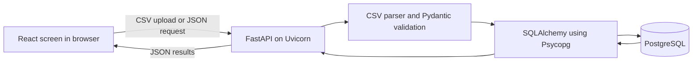

# Minimal stack for a civilian aircraft-status simulation

Checked: **2026-11-07**. Research only; nothing was installed and no application was created. Recommendations below are engineering judgments based on the linked official documentation. Compatibility was checked in documentation and package metadata, not by a local installation test.

Scope: a learning application that uploads **fictional civil transport or disaster-relief exercise status reports**, validates them, saves them, and displays tables and counts. Use synthetic snapshots. This design does not include military operations, weapons, threat analysis, live tracking, or combat-readiness calculations.

## Recommendation

Use **React + TypeScript + Vite**, **Python + FastAPI + Pydantic**, and **PostgreSQL + SQLAlchemy + Psycopg + Alembic**. Start with **CSV only**, parsed by Python's built-in `csv` module. Test the upload and database behavior with **pytest + HTTPX**. Keep one frontend, one backend, and one database in one repository.

This is a deliberately small *full-stack learning project*, rather than the smallest possible website. React's official documentation supports starting with Vite to learn the basics, while explaining that a framework becomes useful when routing, rendering, and data-loading requirements grow. This internal, single-screen dashboard does not initially require those features. [React: build from scratch](https://react.dev/learn/build-a-react-app-from-scratch)

## What each piece does

| Piece | Exact job in this project | Status |
| --- | --- | --- |
| React (`react`, `react-dom`) | Draw the upload form, validation messages, status table, filters, and counts. Components are reusable pieces of the screen. [React](https://react.dev/learn) | Now |
| TypeScript | Check frontend types while developing, such as the fields expected in a status row. It builds on JavaScript; learn JavaScript first. [Handbook](https://www.typescriptlang.org/docs/handbook/intro.html) | Now |
| Vite and its React TypeScript template | Run the frontend development server and build browser files. Keep the template's development packages instead of assembling another build system. [Vite](https://vite.dev/guide/) | Now |
| Browser `fetch` + `FormData` | Send files and request dashboard JSON. No Axios dependency is needed for this first flow. Check unsuccessful HTTP responses explicitly. [MDN Fetch](https://developer.mozilla.org/en-US/docs/Web/API/Fetch_API/Using_Fetch) | Now; browser features |
| Python | Run the backend and file-validation functions. Use a project virtual environment, which isolates installed Python packages. [Python `venv`](https://docs.python.org/3/library/venv.html) | Now |
| FastAPI (`fastapi`) | Define upload and read endpoints, connect validation to HTTP requests, and expose interactive API documentation. [FastAPI](https://fastapi.tiangolo.com/) | Now |
| Pydantic (`pydantic`, version 2 API) | Define permitted input and response fields and validate every parsed file row. It is already a FastAPI dependency; declare it directly when the application imports it. [Pydantic](https://pydantic.dev/docs/validation/latest/get-started/) | Now |
| Uvicorn (`uvicorn`) | Listen for HTTP requests and run the FastAPI application. FastAPI defines the application; Uvicorn runs it. [Uvicorn](https://uvicorn.dev/) | Now |
| `python-multipart` | Decode a browser's multipart file-upload request. Use FastAPI's `UploadFile`; this dependency does **not** read CSV or Excel contents. [File uploads](https://fastapi.tiangolo.com/tutorial/request-files/) | Now |
| Python `csv.DictReader` | Read a CSV into rows using its headers. This is included with Python; pandas is unnecessary for a small, fixed-format import. [Python CSV](https://docs.python.org/3/library/csv.html) | Now; standard library |
| PostgreSQL | Store imports and validated status records so they survive restarts. This is a separately running database, not a Python package. [PostgreSQL tutorial](https://www.postgresql.org/docs/current/tutorial.html) | Now |
| SQLAlchemy (`sqlalchemy`) | Describe database tables, issue queries, and manage transactions. Pydantic describes incoming/outgoing data; SQLAlchemy describes persistence. Use its synchronous API initially. [Unified tutorial](https://docs.sqlalchemy.org/en/21/tutorial/) | Now |
| Psycopg 3 (`psycopg[binary]`) | Carry SQLAlchemy's requests to PostgreSQL. The package is named `psycopg`, not `psycopg3`; the binary extra simplifies local installation. [Psycopg installation](https://www.psycopg.org/install/) | Now |
| Alembic (`alembic`) | Record database-structure changes as versioned migrations, starting with the first schema. Review generated changes before applying them. [Alembic](https://alembic.sqlalchemy.org/en/latest/), [autogeneration](https://alembic.sqlalchemy.org/en/latest/autogenerate.html) | Now |
| pytest + HTTPX (`pytest`, `httpx`) | Run tests and call the API through FastAPI's `TestClient`, without starting an HTTP server. Keep these in development dependencies. [pytest](https://docs.pytest.org/en/stable/getting-started.html), [FastAPI testing](https://fastapi.tiangolo.com/tutorial/testing/) | Now |

For the Python runtime set, choose plain `fastapi` plus the explicit packages above. FastAPI's `standard` extra is convenient but includes optional tools such as templates, email validation, and CLI/deployment tooling that this project does not require. Avoid installing both approaches as separate checklists. [FastAPI dependency groups](https://fastapi.tiangolo.com/#dependencies)

## Supported baseline, rather than copied version numbers

| Component | Suggested starting line | Evidence and caveat |
| --- | --- | --- |
| Node.js | **24 LTS**, current patch | The official release page lists 24 as LTS. Vite documents a minimum of Node 20.19+ / 22.12+; Node 24 clears that floor. Node 20 is already EOL, so an accepted minimum is not a good new-install choice. [Node releases](https://nodejs.org/en/about/previous-releases), [Vite requirements](https://vite.dev/guide/) |
| Python | **CPython 3.14**, current patch, ordinary interpreter build | Python lists 3.14 in bugfix support. Although 3.15 is newer, 3.14 is a conservative compatibility choice for this project. FastAPI and Pydantic package metadata explicitly list 3.14; use Pydantic 2, since Pydantic 1 does not support Python 3.14. [Python support](https://www.python.org/downloads/), [FastAPI metadata](https://pypi.org/project/fastapi/), [Pydantic metadata](https://pypi.org/project/pydantic/) |
| SQLAlchemy / Alembic | Current **stable** releases; use matching documentation | The checked SQLAlchemy current series is 2.1, requiring Python 3.11+. Alembic metadata lists Python 3.14. Avoid mixing old 1.x SQLAlchemy examples into a new project. [SQLAlchemy installation](https://docs.sqlalchemy.org/en/21/intro.html), [Alembic metadata](https://pypi.org/project/alembic/) |
| PostgreSQL / Psycopg | **PostgreSQL 18**, current minor; **Psycopg 3**, stable release | PostgreSQL 18 is supported. Psycopg's installation landing page lists Python 3.10–3.14 and PostgreSQL 10–18. Its development documentation may describe newer interpreter support; do not interpret that as a reason to install a prerelease. [PostgreSQL support](https://www.postgresql.org/support/versioning/), [Psycopg installation](https://www.psycopg.org/install/) |

Use `postgresql+psycopg://...` explicitly for SQLAlchemy's Psycopg 3 connection. Start with `create_engine()` and ordinary `def` endpoints for synchronous database work; this avoids introducing an async database stack. [SQLAlchemy dialect](https://docs.sqlalchemy.org/en/21/dialects/postgresql.html#module-sqlalchemy.dialects.postgresql.psycopg), [FastAPI sync/async guidance](https://fastapi.tiangolo.com/async/)

These release lines are starting recommendations, not a tested lockfile. At implementation time, resolve compatible stable package releases, save the resolved frontend lockfile and Python dependency set, and test them together. Recheck the official requirements before upgrades.

## Minimal architecture and first flow

Proposed behavior, rather than a source requirement:

1. Publish a small CSV template, for example `aircraft_id,display_name,reported_status,source_updated_at,source_name,note`. Use clearly fictional civil aircraft labels and reported statuses `available`, `unavailable`, and `unknown`. Keep freshness separate from the source-reported value; these are reports, not independently verified airworthiness findings.
2. One upload endpoint receives the file. Enforce byte and row limits; require the agreed headers and encoding. Parse CSV first, then pass each row through a Pydantic model. Uploaded CSV fields do not automatically receive request-body validation.
3. Define missing-value, timestamp, duplicate-record, and repeat-upload behavior explicitly. Preserve identifiers as text. Return row-numbered errors. Pydantic can coerce values by default, so choose deliberate conversion/strictness rules. [Pydantic strict mode](https://pydantic.dev/docs/validation/latest/concepts/strict_mode/)
4. Validate the whole small import before saving it in one transaction. Keep an import identifier, timestamps, and source filename; show the selected snapshot and its upload time on the dashboard.
5. One read endpoint returns validated records and ordinary status counts. Refresh after a successful upload or on a Refresh action. Do not add streaming infrastructure for uploaded snapshots.

Keep database credentials on the backend. Vite exposes `VITE_*` values in the browser build, so they cannot hold database passwords. During local development, allow only the actual frontend origin if CORS is needed. [Vite environment variables](https://vite.dev/guide/env-and-mode), [FastAPI CORS](https://fastapi.tiangolo.com/tutorial/cors/)

## Add next, only when the requirement appears

| Need | Addition and decision |
| --- | --- |
| Accept `.xlsx` | Add **openpyxl** for simple worksheet rows. If DataFrame-based cleaning or analysis is genuinely required, add **pandas + openpyxl** and choose `engine="openpyxl"` explicitly. Do not install every Excel engine or `pandas[excel]` for one format. Define sheet, date, blank-cell, and formula handling. pandas publishes Python 3.14 Windows wheels. [openpyxl](https://openpyxl.readthedocs.io/en/stable/), [pandas Excel API](https://pandas.pydata.org/docs/reference/api/pandas.read_excel.html), [pandas package files](https://pypi.org/project/pandas/) |
| Accept untrusted Excel uploads | Add parser protections and resource limits with Excel support. openpyxl specifically recommends `defusedxml` against XML expansion attacks. File extension checks alone do not make a workbook safe. [openpyxl security](https://openpyxl.readthedocs.io/en/stable/#security) |
| Verify the complete browser journey | Add **Playwright Test** (`@playwright/test`) after the basic interface exists: upload a known fixture, see validation feedback, and verify persisted rows after reload. Its documented Node support includes 24; check the operating-system requirements too. [Playwright installation](https://playwright.dev/docs/intro) |
| Share beyond a local learning demo | Implement and test authentication, authorization for uploads and reads, session/logout behavior, and secure deployment **before sharing**. Selecting one JWT package does not implement this whole design. No auth provider is selected here. [FastAPI security guide](https://fastapi.tiangolo.com/tutorial/security/) |
| More screens, repeated server requests, or richer charts | Introduce routing, a query cache, or a charting library when the concrete interface needs it. Begin with React state, semantic HTML tables, CSS, and simple counts. |

Later, measured needs might justify background import jobs, object storage, containers, caching, or more services. None is required for a small bounded CSV import. Do not start with microservices, Kubernetes, Redis, Celery, a separate Express backend, multiple ORMs, two connection pools, vector databases, an LLM API, or agent frameworks. These are scope decisions for this exercise, not claims that those tools are generally unsuitable.

## Learning order

| Learn | Apply it immediately |
| --- | --- |
| [MDN JavaScript foundations](https://developer.mozilla.org/en-US/docs/Learn_web_development/Core/Scripting) | Understand functions, arrays, objects, events, and promises before React; learn enough HTML/CSS to build a basic form. |
| [MDN HTTP overview](https://developer.mozilla.org/en-US/docs/Web/HTTP/Guides/Overview) and [Fetch](https://developer.mozilla.org/en-US/docs/Web/API/Fetch_API/Using_Fetch) | Understand browser/server requests, status codes, JSON, and file upload requests. |
| [React Quick Start](https://react.dev/learn), then [TypeScript Handbook](https://www.typescriptlang.org/docs/handbook/intro.html) | Render a small fixed array, add a filter, then load that array from an API. |
| [Python 3.14 Tutorial](https://docs.python.org/3.14/tutorial/) | Write and test a pure function that validates a few CSV rows. The official tutorial assumes some programming basics. |
| [FastAPI tutorial](https://fastapi.tiangolo.com/tutorial/) | Build one small endpoint and exercise it through the interactive documentation before connecting React. |
| [PostgreSQL tutorial](https://www.postgresql.org/docs/current/tutorial.html), then [SQLAlchemy tutorial](https://docs.sqlalchemy.org/en/21/tutorial/) | Learn tables, keys, `SELECT`, constraints, and transactions; then connect the validated rows to persistence. |

## License check

The checked core sources identify React and Vite as MIT, TypeScript as Apache-2.0, FastAPI as MIT, PostgreSQL under the PostgreSQL License, and Psycopg 3 under LGPL-3.0. Keep the applicable license and notice files with redistributed dependencies, and review the licenses of the actual resolved packages when distributing the application. This is a brief inventory, not a complete transitive-dependency license audit. [React license](https://github.com/react/react/blob/main/LICENSE), [Vite license](https://github.com/vitejs/vite/blob/main/LICENSE), [TypeScript license](https://github.com/microsoft/TypeScript/blob/main/LICENSE.txt), [FastAPI license](https://fastapi.tiangolo.com/#license), [PostgreSQL license](https://www.postgresql.org/about/licence/), [Psycopg license](https://github.com/psycopg/psycopg/blob/master/LICENSE.txt)
